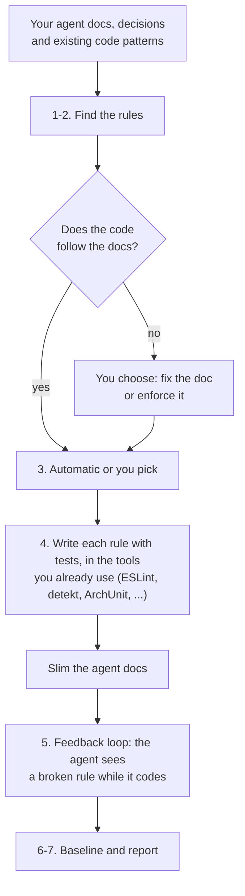

<h1 align="center">codemyrules</h1>
<p align="center">
  <a href="https://www.npmjs.com/package/codemyrules"></a>
  <a href="LICENSE"></a>
  <a href="https://agentskills.io"></a>
  <a href="https://github.com/clirimajeti/agent-rules-bench"></a>
</p>

<h3 align="center">Turn the rules in your agent docs into code rules your agent cannot ignore.</h3>

Every prose rule in `CLAUDE.md`, `AGENTS.md` or an instructions file is read in every agent session, whether the task needs it or not.
The agent can still ignore it.
A lint rule costs nothing until it is broken, and then it says exactly what is wrong.

codemyrules finds the conventions your code and docs already state, writes them as lint rules, slims the agent docs those rules now cover, and lets the agent meet the rules while it codes.

- **Finds your rules** - majority patterns in your code, your decision records (ADRs), and the rules written as prose in your agent docs.
- **Whole stack** - ESLint for JavaScript, TypeScript, Vue and Svelte; ast-grep or your existing linter for Java, Kotlin, Python, Go, C#, PHP, Rust and Ruby.
- **Slimmer agent docs** - every doc line a new rule covers can be deleted, shortened to a pointer, or kept.
- **Silent feedback loop** - the agent sees a broken rule seconds after it writes the code, not days later in review; a passing check costs no tokens.
- **Asks first** - no rule, config change, doc edit, hook or baseline is written without your yes.

## Quick Start

In Claude Code:

```bash
claude plugin marketplace add clirimajeti/codemyrules
claude plugin install codemyrules@codemyrules
```

This also installs the two sub-skills codemyrules drives, [`eslint-pattern-rules`](https://github.com/clirimajeti/eslint-pattern-rules) and [`backend-pattern-rules`](https://github.com/clirimajeti/backend-pattern-rules), as dependencies.

The feedback loop's hooks ship as the [`codemyrules`](https://www.npmjs.com/package/codemyrules) npm package.
The skill installs it when you set up the loop, or install it yourself:

```bash
npm install -g codemyrules
```

Then ask in your own words.
The skill is model-invoked, so there is no command to remember:

- "Turn our ADRs and AGENTS.md into lint rules."
- "Our CLAUDE.md is too long. Which of it could a linter enforce instead?"
- "Set up lint feedback for agents in this repo."

<details>
<summary><strong>Codex, Copilot, Cursor and others</strong></summary>

```bash
npx skills add clirimajeti/codemyrules
npx skills add clirimajeti/eslint-pattern-rules
npx skills add clirimajeti/backend-pattern-rules
```

The rules work in every harness.
The feedback loop runs in Claude Code and pi, see [Harness support](#harness-support).

</details>

<details>
<summary><strong>npm (the feedback loop only)</strong></summary>

The [`codemyrules`](https://www.npmjs.com/package/codemyrules) npm package holds the feedback loop's hooks and its CLI, without the skill.
The skill installs it for you when you set up the loop, but you can also install it yourself and set up the loop by hand:

```bash
npm install -g codemyrules
codemyrules install . --config loop.json           # dry run: shows the plan
codemyrules install . --config loop.json --apply   # installs the hooks
codemyrules install . --config loop.json --harness pi --apply   # or the pi extension (claude,pi for both)
```

`loop.json` names your linters per tier and the files the guard protects:

```json
{
  "linters": [
    { "name": "eslint", "format": "eslint", "tier": "full", "extensions": [".ts", ".tsx"],
      "command": ["node_modules/.bin/eslint", "--format", "json", "{files}"] }
  ],
  "protect": ["**/eslint.config.*", "eslint-rules/**"]
}
```

The installer checks the config and refuses a broken one before it writes anything.
Formats are `eslint`, `ast-grep` and `ruff`, and the tiers are `fast` (after every edit) and `full` (at the end of each turn); step 5 of [`SKILL.md`](skills/codemyrules/SKILL.md) has every option.
It needs Node 22 or later and Claude Code or pi.

</details>

<details>
<summary><strong>Manual</strong></summary>

Copy `skills/codemyrules/` into your agent's skills folder, for example `~/.claude/skills/codemyrules/`, next to the two sub-skills.
When a sub-skill is not installed, the skill asks for the path to its `SKILL.md`.

</details>

## Example

A decision record says:

> We inject `java.time.Clock`. Production code calls `Instant.now(clock)`, never a bare `Instant.now()`.

codemyrules offers it as a candidate labelled `documented, not enforced`, and on your yes writes an ast-grep rule with tests:

```yaml
id: use-clock-injection
language: Kotlin
severity: error
message: $T.now() without a clock (ADR 0043). Use $T.now(clock) instead.
rule:
  pattern: $T.now()
constraints:
  T: { regex: '^(Instant|LocalDate|LocalDateTime|ZonedDateTime|OffsetDateTime)$' }
```

The agent-doc line that said the same thing becomes a one-line pointer in the folder's `CLAUDE.md`.
When the agent then writes `Instant.now()`, the feedback loop tells it within seconds:

```
src/main/kotlin/mail/MailSender.kt:42 use-clock-injection Instant.now() without a clock (ADR 0043). Use Instant.now(clock) instead.
```

## Why Rules Instead of Prose

The defaults come from an experiment: 124 headless Claude Code sessions on two isolated copies of a real Kotlin/Spring backend.
It compared a rule written as prose with the same rule as a lint rule plus the feedback loop.
The tested rule was design-shaping (time through an injected `Clock`); a second, mechanical rule (lowercase log messages) was tested alongside.

| Setup | Runs left with the rule broken | Cost per task, including a review fix |
|---|---|---|
| Prose in a linked instructions file | most runs (Sonnet 8 of 8, Haiku 5 of 8) | baseline |
| Rule only, prose deleted | 0 | higher: the agent writes the wrong shape first and reworks it |
| Rule plus a one-line pointer in the folder's `CLAUDE.md` | 0 | about 22% lower, with a third fewer turns |
| Prose always loaded (root `AGENTS.md`), same batch as the row below | 0 of 12 | baseline for this comparison |
| Rule plus pointer, the rest of that prose kept | 0 of 12 | about the same (+6%, inside the spread) |

- The first draft with the rule costs more, because it writes the correct code; the saving comes from never needing a fix round.
- The mechanical rule was never broken, even with its prose deleted.
- Prose repeated the same break in every follow-up session, copying its own earlier code.
- Prose the agent always loads is followed too: there the rule adds a guarantee at no measurable cost, and every always-loaded line it lets you delete saves about $0.009 per 1,000 tokens per Sonnet session.
- So the token saving comes from slimmer always-loaded docs and from avoided fix rounds where prose is not seen, not from rules making a session cheaper by themselves.
- Limits: one module, two rules, 8-12 runs per setup with a wide spread, and an idealised review.

So codemyrules recommends: for a mechanical rule, the rule only; for a design-shaping rule, the rule plus a one-line pointer in the folder-level `CLAUDE.md`.

The method, the harness to rerun it on your own repo, and related work are in [agent-rules-bench](https://github.com/clirimajeti/agent-rules-bench).

## How It Works

The [flowchart](#flowchart) at the end shows the same steps.

1. **Detects your stacks** and maps each source root to its sub-skill.
2. **Discovers candidates** through each sub-skill: your code's majority patterns, your decision records, the rules written as prose in your agent docs, and well-known rules your linters have but you don't use yet.
   A doc line the code no longer follows is raised as a question: update the doc to match the code, or enforce the doc.
3. **Selects the rules** after one first question: automatic or manual.
   Automatic builds every recommended rule and asks only for doc changes, doc-vs-code contradictions and high-risk rules.
   Manual shows every candidate in one selection, recommended ones marked, and builds only what you pick.
4. **Builds each pick** through the sub-skill that owns its stack: design questions, the rule and its tests, verification on your real code.
   It first checks which tools the project already uses, and writes the rule there, in their style: ESLint, detekt, Ruff, or an existing ArchUnit or Konsist test class; ast-grep only when none of them fits.
   Then, for each line in your agent docs the new rule enforces, you choose to delete it, shorten it to a pointer, or keep it.
   A pointer you keep can move to a `CLAUDE.md` in the folder it applies to, so it loads only when the agent works there.
5. **Sets up the feedback loop**: automatic mode installs it, manual mode asks first after showing exactly what it installs.
6. **Records a baseline**: agent-doc tokens, rules and open hits, so a later run can show what changed.
7. **Reports** the rules, doc lines removed, the loop and the baseline, and on a re-run the before and after.

A rule your existing code already breaks goes into a suggestions layer (`eslint.config.suggestions.mjs`, `sgconfig.suggestions.yml`).
CI stays green, and the feedback loop still applies the rule to new code, so the agent stops copying the old pattern.

### What it reads

| Source | Where |
|---|---|
| Decision records | `docs/adr/`, `docs/decisions/`, `notes/decisions/`, `ADR-*.md`, `CONTRIBUTING` |
| Agent docs | `CLAUDE.md`, `AGENTS.md`, `GEMINI.md`, `.github/copilot-instructions.md`, `.github/instructions/`, `.cursor/rules/`, `.cursorrules`, `.windsurfrules` |
| Docs linked from agent docs | `@file` imports and Markdown links to repo files, followed through linked files too (an `index.md` and the topic files it links) |
| Code | majority patterns, and code that goes around the project's own helpers |

## The Feedback Loop

Three tiers, each silent when clean:

| Tier | When | What runs |
|---|---|---|
| Fast | after every edit | ast-grep, and ESLint through `eslint_d` when you have it, on the edited file |
| Full | at the end of each turn | all configured linters on the files the agent edited in this turn |
| Safety net | CI | your own lint run, including slow JVM tools like detekt |

- **Only new code blocks.**
  Only errors on lines changed since `HEAD` block, so the agent never fixes unrelated legacy code.
  The loop runs the suggestions layer, so rules the old code breaks still guard new code; warnings never block.
- **Rules cannot be quietly weakened.**
  A guard asks you before any edit that adds or moves an ignore comment or changes a lint config, rule file or baseline.
  A change made through `Bash` or `NotebookEdit` cannot be asked about first, so it is checked right after, and the agent is told to undo it or ask you.
- **Private.**
  The hooks go into `.claude/settings.local.json` (in pi, the extension into `.pi/extensions/codemyrules.js`), the config into `.claude/codemyrules/`, and all of them into `.git/info/exclude`.
  No tracked file changes.
  Sharing it with your team is a later, separate step.
- **Pinned per project.**
  The installer copies the globally installed [`codemyrules`](https://www.npmjs.com/package/codemyrules) npm package into `.claude/codemyrules/pkg/` and records its version and sha256 in `pin.json`, and the hooks run that copy.
  `npm update -g codemyrules` changes no project: a new release runs in a project only after `codemyrules install . --apply` there, whose dry run shows the version change first.
  A bad or compromised release therefore never reaches your projects on its own.

`codemyrules status .` shows what is installed and what failed lately; `codemyrules uninstall . --apply` removes it again (dry run without `--apply`).
[`references/feedback-loop.md`](skills/codemyrules/references/feedback-loop.md) has the details.

## Harness Support

| | Rules and doc cleanup | Feedback loop |
|---|---|---|
| Claude Code | yes | yes, through hooks |
| [pi](https://github.com/earendil-works/pi-coding-agent) | yes | yes, through a project extension (`codemyrules install . --harness pi --apply`) |
| Codex, Copilot, Cursor and others | yes | not yet |

In pi the guard asks through pi's own confirm dialog; in print or JSON mode, with nobody to ask, a flagged edit is refused.
pi loads project extensions only in a trusted project (`/trust`, or `-a` for one run).
Support for Codex, OpenCode and other harnesses is in progress.
If your harness has hooks or a plugin API and you want it supported, open an issue.

## What It Leaves Alone

- **Anything you have not approved**: no rule, config change, doc edit, hook or baseline is written without your yes; choosing automatic mode is that yes for the recommended rules, the loop and the baseline, never for a doc edit.
- **Build files and lockfiles**, as in both sub-skills.
- **Your agent docs**, except the lines you approve deleting, shortening or moving.

## Development

```
skills/codemyrules/
├── SKILL.md                    # the workflow
├── agents/openai.yaml          # Codex picker metadata
├── references/
│   └── feedback-loop.md        # tiers, what blocks, the guard, the log, uninstall
└── scripts/
    ├── cli.mjs                 # the `codemyrules` command of the npm package: hooks, install, measure
    ├── install.mjs             # installs the loop in a project (dry run by default)
    ├── measure.mjs             # baseline and before/after report
    ├── core/                   # harness-neutral: checks, snapshot, lint loop, git and linter helpers
    ├── guard.mjs               # Claude Code adapter: PreToolUse hook on edits
    ├── shell-guard.mjs         # Claude Code adapter: Pre- and PostToolUse hook on Bash and NotebookEdit
    ├── lint-edited.mjs         # Claude Code adapter: PostToolUse hook, fast tier
    ├── lint-turn.mjs           # Claude Code adapter: Stop hook, all tiers
    ├── pi.mjs                  # pi adapter: extension with the guard, shell guard and both tiers
    └── test/                   # node:test suites, and release-check.mjs
evals/                          # claude plugin eval cases for the skill
scripts/eval.sh                 # runs them, with the two sub-skill plugins staged next to it
```

Run the tests with `npm test`.
Before a release, `npm run release-check` packs the package, installs it into a throwaway npm prefix and drives a few headless Claude Code sessions (Haiku) against it in a throwaway repo; it needs `claude` logged in and takes about a minute.
To run the hooks from a working copy, run `npm link` in the repository root: the global `codemyrules` command then points at it, and a reinstall in a test project pins a copy of it (reinstall after each change).
`npm run eval` runs the skill's eval cases with `claude plugin eval` (pass `-- --runs 3` and the like through); it copies the two sibling sub-skill checkouts into `.eval-deps/` first, because an eval loads no other plugins.
A release bumps the version in `package.json`, `.claude-plugin/plugin.json` and `SKILL.md` (a test checks they match), runs `npm publish`, and only then pushes, so the skill never names an unpublished version.
## Flowchart



## Related

- [eslint-pattern-rules](https://github.com/clirimajeti/eslint-pattern-rules) - the frontend sub-skill.
- [backend-pattern-rules](https://github.com/clirimajeti/backend-pattern-rules) - the backend sub-skill.
- [agent-rules-bench](https://github.com/clirimajeti/agent-rules-bench) - the benchmark behind the defaults.

## License

[MIT](LICENSE)
